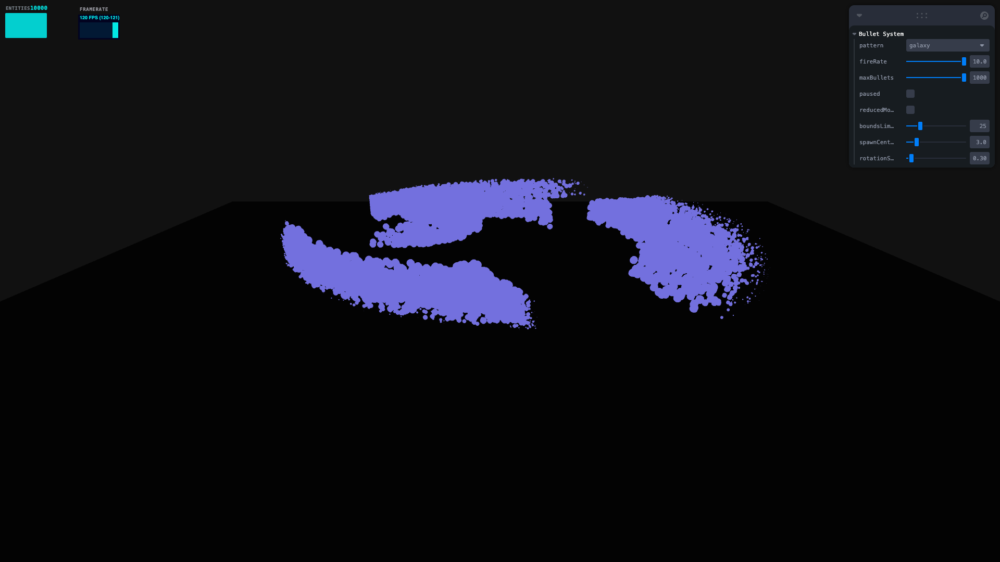

# @k9kbdev/r3f-projectiles

A composable, GPU-instanced projectile system for React Three Fiber. Render 20,000 simultaneous bullets at 120 fps on a loop that allocates nothing per frame or per bullet of its own — with three named exceptions, spelled out under [Near-Zero-Allocation Render Loop](#near-zero-allocation-render-loop).

[](https://www.npmjs.com/package/@k9kbdev/r3f-projectiles)
[](./LICENSE)
[](https://bundlephobia.com/package/@k9kbdev/r3f-projectiles)

```tsx
import { Canvas } from '@react-three/fiber';
import { BulletManager } from '@k9kbdev/r3f-projectiles';

export default function App() {
  return (
    <Canvas>
      <BulletManager pattern="fibonacciSphere" fireRate={2} />
    </Canvas>
  );
}
```

---

## Core Capabilities

- **Composable Patterns**: Chain `gen → mod → compose` to build complex bullet hells from simple math.
- **GPU Instancing**: Push 20,000 bullets at 120 fps through a single `<instancedMesh>`.
- **Many Emitters, One Pool**: `<BulletField>` + `<Emitter>` give N shooters one mesh, one pool, and one frame loop — declaratively for a player weapon, or through `fireAt` for a swarm with no components at all.
- **Aimable**: `gen.arc` fires a directional cone that widens continuously into a full ring, and `origin` lets a moving emitter shoot from wherever it currently is.
- **Yours to Collide**: `forEachActive` walks live bullets so hit detection stays in your code, and an opaque `payload` integer carries whatever per-bullet state the library shouldn't know about — packed into named bitfields with `definePayload` if you need more than one number.
- **Fixed-Step Ready**: `stepMode="manual"` takes the simulation off the render clock. Your fixed-timestep loop calls `step(dt)`; the field uploads once per frame. Same inputs, same bullets — bit for bit, however the steps fall into frames.
- **Headless When You Need It**: `createBulletSimulation()` from the React-free `/core` entry is the bullet simulation itself — the very code `<BulletField>` runs — with no React, renderer or DOM. Step it from your own fixed tick, replay it in a plain function, hash it for desync checks, and draw it with `<BulletField simulation={sim} />`. See [Headless simulation](#headless-simulation-games-with-a-fixed-tick).
- **Same Bits on Every Engine**: every built-in generator and modifier runs on the library's own sine and cosine (a port of fdlibm) instead of `Math.sin` / `Math.cos`, so a burst's spawn data is bit-identical in Chrome, Firefox, Safari and Node for a given library version. The same functions are yours from `/detmath`. See [Deterministic sin and cos](#deterministic-sin-and-cos-detmath).
- **Near-Zero Allocation**: I create scratch `Object3D`, `Vector3`, and `Color` objects once and reuse them every frame, so nothing is allocated per bullet. Three per-burst/per-flush exceptions are named under [Near-Zero-Allocation Render Loop](#near-zero-allocation-render-loop). No garbage collection spikes.
- **Object Pooling**: `acquire()` and `releaseSpawnData()` recycle object state to eliminate allocation pressure.
- **Shaped, Aimed, Outlined**: Swap the sphere for any geometry (`bulletGeometry.arrow()`, a textured sprite quad, your own mesh), point each bullet along its velocity or at the camera with `orient`, and draw a readable dark rim with `outline` — one extra draw call, no extra per-bullet work.
- **Many Looks, One Draw**: `frames` gives every bullet its own cell of a sprite atlas, picked from its payload, and `orient="camera-velocity"` turns screen-aligned pixel sprites toward where they fly — a whole bullet hell's worth of arrows, orbs and shards in one mesh.
- **Accessibility Built-In**: Use `reducedMotion` to render a static, zero-velocity snapshot for motion-sensitive users.
- **Tree-Shakeable**: Import raw pattern math from `@k9kbdev/r3f-projectiles/patterns` and the headless simulation from `@k9kbdev/r3f-projectiles/core`. Leave React behind if you don't need it.
- **TypeScript Native**: Shipped with complete type definitions.

---

## Installation

```bash
npm install @k9kbdev/r3f-projectiles
```

### Peer dependencies

| Package | Version |
|---|---|
| `react` | `≥ 18` |
| `@react-three/fiber` | `≥ 8` |
| `three` | `≥ 0.150` |

The React-free entries (`/core`, `/patterns`) load only `three` at run time. The package still declares React and R3F as peers, so npm installs them alongside it, but nothing on those entries ever imports them — a headless replay or a server can use them without a DOM or a renderer.

---

## Stress Test

**[Play the live interactive demo here.](https://kaleb-kougl.github.io/r3f-projectiles/)**




Run the built-in stress test to see it scale:

```bash
npm run dev:stress
```

Spin up a local Vite server. Toggle patterns, crank the fire rate, and spawn 20,000 bullets while monitoring framerate, render time, and memory usage.

---

## Quick Start

```tsx
import { useRef } from 'react';
import { Canvas } from '@react-three/fiber';
import {
  BulletManager,
  gen, mod, compose,
  type BulletManagerHandle,
} from '@k9kbdev/r3f-projectiles';

function Scene() {
  const ref = useRef<BulletManagerHandle>(null);

  return (
    <>
      <BulletManager
        ref={ref}
        pattern={() => compose(gen.ring(80, 3), mod.color(0x39ff14))}
        fireRate={2}
        onBulletCount={(n) => console.log('active:', n)}
      />
      <mesh onClick={() => ref.current?.fire()}>
        <boxGeometry />
        <meshBasicMaterial color="white" />
      </mesh>
    </>
  );
}

export default function App() {
  return (
    <Canvas camera={{ position: [0, 6, 12] }}>
      <Scene />
    </Canvas>
  );
}
```

---

## API Reference

### `<BulletManager>`

A props-driven R3F component backed by a single `<instancedMesh>`. Pass a `ref` for imperative control.

One component, one emitter: one mesh, one pool, one origin, one pattern, one cadence. When a second thing starts shooting, see [`<BulletField>` + `<Emitter>`](#bulletfield--emitter).

#### Props

| Prop | Type | Default | Description |
|---|---|---|---|
| `maxBullets` | `number` | `2000` | Maximum concurrent bullet instances. |
| `pattern` | `PatternKey \| PatternFactory` | `'fibonacciSphere'` | Built-in pattern name or custom factory function. |
| `fireRate` | `number` | `1.5` | Shots per second. |
| `paused` | `boolean` | `false` | Freeze the simulation (bullets hold position). |
| `reducedMotion` | `boolean` | `false` | Spawn a single static snapshot with zero velocity. |
| `boundsLimit` | `number` | `25` | Half-extent of the cull **cube** (per axis, not a radius), in the field's local coordinates. `Infinity` disables bounds culling. See [Bounds culling](#bounds-culling). |
| `boundsCenter` | `{ current: Vector3 \| null }` | — | Centre of the cull cube, re-read every step so it can follow a player or camera. Omit for the origin. |
| `stepMode` | `'auto' \| 'manual'` | `'auto'` | `'manual'` stops frames from advancing the simulation; drive it with `ref.step(dt)`. See [Manual stepping](#manual-stepping-stepmodemanual). |
| `spawnCenterY` | `number` | `3` | Y-coordinate of the spawn center. |
| `rotationSpeed` | `number` | `0.3` | Radians/second for the source-position orbit. |
| `origin` | `{ current: Vector3 \| null }` | — | Emitter position, re-read at every shot so a moving source fires from where it actually is. Omit for the built-in orbit. |
| `bulletRadius` | `number` | `0.12` | Radius of each bullet sphere — or, with a custom `geometry`, the scale applied to it. |
| `fadeTime` | `number` | `1` | Seconds of fade-out at the end of a bullet's life; `0` disables it. See [Fade & easing](#fade--easing). |
| `fadeCurve` | `EasingName \| EasingFn` | `'linear'` | Shape of that fade. |
| `children` | `ReactNode` | `<meshBasicMaterial fog={false} />` | Custom material override. |
| `onBulletCount` | `(count: number) => void` | — | Called once per frame with the active bullet count. Under `stepMode="manual"`, only on frames in which a step ran. |
| `geometry` | `BufferGeometry` | sphere | Bullet shape, unit-sized, forward +X, up +Y. **Never disposed by the manager.** See [Bullet geometry](#bullet-geometry). |
| `orient` | `'none' \| 'velocity' \| 'camera'` | `'none'` | Rotate each bullet along its velocity, or billboard it to the camera. See [Orientation](#orientation). |
| `outline` | `{ color, width, mode? }` | — | A uniform-color rim behind every bullet. See [Outlines](#outlines). |

#### Built-in `PatternKey` values

| Key | Description |
|---|---|
| `'fibonacciSphere'` | Golden-angle sphere — even omni-directional burst. |
| `'torusKnot'` | Parametric (2,3) torus knot. |
| `'galaxy'` | Logarithmic spiral-arm galaxy. |
| `'helix'` | DNA-style double helix. |
| `'rose3D'` | 3D rhodonea rose curve. |
| `'ring'` | Flat ring expanding outward. |
| `'arc'` | Flat directional arc — a ring narrowed to a cone. |

Human-readable labels for UI dropdowns are available via `PATTERN_LABELS`:

```ts
import { PATTERN_LABELS } from '@k9kbdev/r3f-projectiles';
// { fibonacciSphere: 'Fibonacci Sphere', torusKnot: 'Torus Knot', … }
```

---

### `<BulletField>` + `<Emitter>`

`<BulletManager>` binds five things together: one mesh, one pool, one origin, one pattern, one cadence. That holds up until something other than the player shoots — then N shooters means N managers, which means N pools and N draw calls, plus a pool reallocation every time a shooter spawns or dies.

`<BulletField>` unbinds them. The field owns the mesh, the slot pool, and the single frame loop. Emitters own an origin, a pattern, and a cadence, and render nothing.

```tsx
import { useRef } from 'react';
import { Vector3 } from 'three';
import { BulletField, Emitter, gen, mod, compose } from '@k9kbdev/r3f-projectiles';

const bossPattern = () => compose(gen.ring(80, 3), mod.color(0xff3355));
const turretPattern = () => compose(gen.arc(31, Math.PI / 6, 4), mod.color(0x33ccff));

function Scene() {
  const bossRef = useRef(new Vector3(0, 3, 0));
  const turretRef = useRef(new Vector3(4, 1, 0));

  return (
    <BulletField
      maxBullets={2000}
      bulletRadius={0.2}
      material={<meshStandardMaterial emissive="hotpink" emissiveIntensity={2} />}
    >
      <Emitter origin={bossRef} pattern={bossPattern} fireRate={3} />
      <Emitter origin={turretRef} pattern={turretPattern} fireRate={1} />
    </BulletField>
  );
}
```

Two emitters, one `<instancedMesh>`, one pool, one `useFrame`. The material is a prop rather than a child because `children` carries the emitters — see [One field, one material](#one-field-one-material).

`<BulletManager>` is not deprecated and is not going away. It *is* this pair with exactly one emitter, and it remains the one-emitter convenience: every prop, default, and imperative method is unchanged, because at N=1 field props and emitter props are indistinguishable from the outside. Two behaviours did move in 0.4.0, and they move for `<BulletManager>` too — `reducedMotion` now snapshots at your `origin` rather than at the static centre, and `mod.scale` stopped being inert. Both are in the [changelog](./CHANGELOG.md); neither affects a consumer who used neither.

#### `<BulletField>` props

| Prop | Type | Default | Description |
|---|---|---|---|
| `maxBullets` | `number` | `2000` | Maximum concurrent bullet instances, shared by every emitter. |
| `boundsLimit` | `number` | `25` | Half-extent of the cull **cube** (per axis, not a radius), in the field's local coordinates. `Infinity` disables bounds culling. See [Bounds culling](#bounds-culling). |
| `boundsCenter` | `{ current: Vector3 \| null }` | — | Centre of the cull cube, re-read every step so it can follow a player or camera. Omit for the field's origin. |
| `bulletRadius` | `number` | `0.12` | Radius of each bullet sphere — or, with a custom `geometry`, the scale applied to it. Per-bullet `mod.scale` multiplies against it. |
| `fadeTime` | `number` | `1` | Seconds of fade-out at the end of a bullet's life; `0` disables it. See [Fade & easing](#fade--easing). |
| `fadeCurve` | `EasingName \| EasingFn` | `'linear'` | Shape of that fade. |
| `paused` | `boolean` | `false` | Freeze the simulation (bullets hold position). |
| `reducedMotion` | `boolean` | `false` | Spawn one static, zero-velocity snapshot **per emitter**, then freeze. |
| `stepMode` | `'auto' \| 'manual'` | `'auto'` | Who advances the simulation: the field, once per rendered frame, or you, through `step(dt)`. See [Manual stepping](#manual-stepping-stepmodemanual). |
| `onBulletCount` | `(count: number) => void` | — | Called once per frame with the active bullet count, across all emitters. Under `stepMode="manual"`, only on frames in which a step ran. |
| `onPoolExhausted` | `(emitterId, requested, spawned, reason) => void` | — | Called once per burst that could not be filled, with `reason` naming which constraint bound. See [One pool, first-come, first-served](#one-pool-first-come-first-served). |
| `material` | `ReactNode` | `<meshBasicMaterial fog={false} />` | The shared mesh's material. One field, one material. |
| `geometry` | `BufferGeometry` | sphere | Bullet shape, unit-sized, forward +X, up +Y. **Never disposed by the field.** See [Bullet geometry](#bullet-geometry). |
| `orient` | `'none' \| 'velocity' \| 'camera' \| 'camera-velocity'` | `'none'` | Rotate each bullet along its velocity, billboard it to the camera, or both (0.7.0: a billboard turned toward the on-screen heading). See [Orientation](#orientation). |
| `outline` | `{ color, width, mode? }` | — | A uniform-color rim behind every bullet, from a second mesh sharing this field's instance matrices. See [Outlines](#outlines). |
| `frames` | `{ columns, rows, frame, upright? }` | — | 0.7.0: per-bullet **sprite frames** from one atlas — `frame(index, payload)` picks each bullet's cell. Needs a `geometry` with quad UVs. See [Sprite atlases: per-bullet frames](#sprite-atlases-per-bullet-frames). |
| `simulation` | `BulletSimulation` | — | Render a simulation **you own** (from `createBulletSimulation`) instead of running one. The field then never steps, spawns or culls; it syncs matrices once per frame. Simulation props (`maxBullets`, `boundsLimit`, `boundsCenter`, `fadeTime`, `fadeCurve`, `paused`, `reducedMotion`, `stepMode`, `onPoolExhausted`) are ignored and `<Emitter>` children throw. See [Rendering a simulation you own](#rendering-a-simulation-you-own-bulletfield-simulation). |
| `interpolate` | `() => number` | — | With `simulation` (created with `interpolation: true`): the fraction of a step to draw between the last two steps, read once per frame. |
| `children` | `ReactNode` | — | The field's `<Emitter>` elements. Not allowed with `simulation`. |

#### `<Emitter>` props

| Prop | Type | Default | Description |
|---|---|---|---|
| `pattern` | `PatternKey \| PatternFactory` | `'fibonacciSphere'` | Built-in pattern name or custom factory function. |
| `fireRate` | `number` | `1.5` | Shots per second. `0` never auto-fires — use it for a manual-only emitter. |
| `origin` | `{ current: Vector3 \| null }` | — | Emitter position, re-read at every shot so a moving source fires from where it actually is. Omit for the built-in orbit. |
| `spawnCenterY` | `number` | `3` | Y-coordinate of this emitter's static spawn centre. |
| `rotationSpeed` | `number` | `0.3` | Radians/second for this emitter's orbit, used only when `origin` is omitted. |

Each emitter keeps its own cadence, its own orbit phase, and its own reduced-motion snapshot. An `<Emitter>` rendered outside a `<BulletField>` — or inside one that renders an external [`simulation`](#rendering-a-simulation-you-own-bulletfield-simulation), which nothing in the field steps — throws during render, so the mistake points at the offending JSX instead of producing an emitter that silently never fires.

Pass an `<Emitter>` a `ref` for `fire()` — one burst, right now. It is deliberately *not* the operation the frame loop performs, and the differences are the ones `<BulletManager>.fire()` has always had: it fires from this emitter's `origin`, falling back to a static `(0, spawnCenterY, 0)` rather than the orbit; it advances neither the cadence timer nor the orbit phase; and it works while the field is `paused`.

```tsx
import { useRef } from 'react';
import type { Vector3 } from 'three';
import { BulletField, Emitter, type EmitterHandle } from '@k9kbdev/r3f-projectiles';

function PlayerWeapon({ playerRef }: { playerRef: React.RefObject<Vector3 | null> }) {
  const weapon = useRef<EmitterHandle>(null);

  return (
    <>
      <BulletField maxBullets={1000}>
        <Emitter ref={weapon} origin={playerRef} pattern="arc" fireRate={0} />
      </BulletField>
      <mesh onClick={() => weapon.current?.fire()}>
        <boxGeometry />
        <meshBasicMaterial color="white" />
      </mesh>
    </>
  );
}
```

#### Two ways to spawn, and how to choose

`<Emitter>` is for **stable, few, declarative** emitters — a player's weapon, a handful of fixed turrets. Anything you would happily write into JSX and leave mounted.

It is the wrong tool for a swarm. One `<Emitter>` per enemy means a React component mounting and unmounting per entity, which is exactly the per-entity churn a pooled game exists to avoid: you would remove that cost at the bullet layer and pay it straight back at the component layer. Emitters that are pool rows rather than components should skip the component and drive the field's handle directly — `acquireEmitter()` on spawn, `fireAt()` from your own loop, `releaseEmitter()` on death. No components, no mount churn, no cap on how many shooters you can have.

```tsx
import { useRef } from 'react';
import { useFrame } from '@react-three/fiber';
import { Vector3 } from 'three';
import {
  BulletField,
  gen, mod, compose,
  type BulletFieldHandle,
} from '@k9kbdev/r3f-projectiles';

interface Archer {
  position: Vector3;
  emitterId: number;
  cooldown: number;
}

const arrow = () => compose(gen.arc(5, Math.PI / 8, 6), mod.payload(3));

function Swarm({ archers }: { archers: Archer[] }) {
  const field = useRef<BulletFieldHandle>(null);

  useFrame((_state, delta) => {
    const f = field.current;
    if (!f) return;

    for (const archer of archers) {
      archer.cooldown -= delta;
      if (archer.cooldown > 0) continue;
      archer.cooldown = 0.8;                            // your cadence, not the field's
      f.fireAt(archer.position, arrow, archer.emitterId);
    }
  });

  return <BulletField ref={field} maxBullets={4000} />;
}

// On spawn, next to the pool row itself:
archer.emitterId = field.current.acquireEmitter();

// On death:
field.current.releaseEmitter(archer.emitterId);
```

`fireAt` copies the origin vector immediately, so you can hand it a live entity position and mutate it the moment the call returns. It has no cadence of its own — that is the point; the loop that owns the entity owns the timing.

Both paths draw from the same pool, the same mesh, and the same id counter, so one field can mix them freely: a declarative `<Emitter>` for the player alongside a hundred imperative ids for the swarm.

#### Emitter ids

Ids are **issued by the field**, start at `1`, and are **never recycled**. `0` is reserved and means "anonymous" — it is what `fireAt` attributes a burst to when you pass no id, and `clear(0)` then clears exactly those bullets and nothing else.

- **`<Emitter>` registration *is* the acquire.** There is no `id` prop, on purpose: an id you choose could collide with a live emitter's, and provenance that can collide is not provenance. The field stamps an id at mount and retires it at unmount, so an emitter that remounts is a genuinely new emitter with a new id rather than an heir to the old one's bullets.
- **Imperative consumers call `acquireEmitter()` and `releaseEmitter(id)`**, storing the id alongside the pool row it belongs to.

**`releaseEmitter` does not clear bullets.** Its contract is almost entirely negative, so it is worth stating in full: it does not deactivate that emitter's in-flight bullets, does not re-attribute them to anyone else, and does not touch any other emitter. Because ids never recycle, those bullets keep the id they were stamped with and stay correctly attributed in `forEachActive` for the rest of their lives — long after the archer that fired them is dead. A consumer who wants them gone says so:

```ts
field.clear(archer.emitterId);           // optional — the arrows die with the archer
field.releaseEmitter(archer.emitterId);  // retire the id
```

Separating those two is the whole point of provenance: an arrow already in the air is not obviously the dying archer's problem, and the library refuses to decide for you. Nothing is reclaimed by the release itself — a counter that never recycles has nothing to free — but call it anyway. It is where the contract is written down, and it advances the field's counter past any id you supply yourself, so an id you invented can never later be issued to somebody else.

#### One pool, first-come, first-served

The pool is shared and finite. Emitters are serviced in registration order — which is mount order, which is JSX order — and **when the field is full, the newest burst is the one that gets dropped.** A live bullet is never recycled out from under you: recycling would rewrite the `payload` and `emitterId` of a bullet you may be holding an index to inside `forEachActive`, and that is a phantom hit attributed to the wrong emitter.

So a high-cadence emitter registered first can crowd out one registered later. There is no per-emitter reserve, deliberately — quotas would need a policy for unclaimed reserve and would introduce a field that refuses to spawn into slots it has free. The honest remedies are the blunt ones: **raise `maxBullets`, or slow the greedy emitter's `fireRate`.**

Two things keep this observable rather than silent:

- **`onPoolExhausted(emitterId, requested, spawned, reason)`** fires once per short-changed burst — never once per dropped bullet, so a 100-bullet burst into a full pool produces exactly one call. It is raised from every spawn path: auto-fire, `fire()`, `fireAt()`, and the reduced-motion snapshot when the 200-bullet budget truncates it. One gap, stated rather than glossed: an emitter that reaches the snapshot with the budget **already** at zero is dropped silently. The field skips it before calling its pattern factory, so it never learns what that emitter would have asked for, and allocating a burst purely to report throwing it away is not a trade worth making.
- **`activeCountFor(emitterId)`** counts the live bullets carrying an id, so a consumer can decide not to fire at all.

`reason` is a `PoolExhaustionReason` — a string union exported from the package root, for when you need to name the parameter's type on a standalone handler. It exists because the two ways to come up short want different responses:

| `reason` | What ran out | What to do about it |
|---|---|---|
| `'pool-full'` | The shared slot pool had no free slots left. | Raise `maxBullets`, or slow the greedy emitter's `fireRate`. |
| `'reduced-motion-budget'` | The field-wide 200-bullet reduced-motion snapshot budget was spent by emitters served earlier. | Nothing — the cap is deliberately not configurable, and the pool may be almost empty. See [Motion Sensitivity](#motion-sensitivity). |

Without the discriminator the only actionable response to the callback is a guess: `maxBullets` is the obvious lever and it is the wrong one for half the cases.

```tsx
<BulletField
  maxBullets={2000}
  onPoolExhausted={(emitterId, requested, spawned, reason) => {
    if (reason === 'pool-full') {
      console.warn(`emitter ${emitterId} dropped ${requested - spawned} of ${requested}`);
    }
  }}
>
  <Emitter pattern="galaxy" fireRate={4} />
</BulletField>
```

Read nothing else into service order. It is specified so that exhaustion is deterministic and testable, not so you can sequence gameplay with it — and an emitter that unmounts and remounts moves to the **tail** of the registry, and therefore to last priority under a full pool.

#### One field, one material

A field renders one `<instancedMesh>`, so it has exactly one material. The `material` prop says that in the type signature rather than in a paragraph you have to find. Per-bullet **color** still varies freely via `mod.color`, so mixed-hue emitters share a field for free; what cannot vary is the material itself.

A second material therefore means a second `<BulletField>` — which means a second pool, which is the exact cost the split exists to remove. (Different *looks* do not need different materials: since 0.7.0 one textured material can show a different atlas cell per bullet — see [Sprite atlases](#sprite-atlases-per-bullet-frames).) So **partition emitters by material, not by faction or entity type.** A shader change earns a new field; a faction does not. Every emitter that draws with the same emissive material belongs in one field whether it belongs to the player or the boss.

```tsx
<>
  <BulletField maxBullets={1500} material={<meshBasicMaterial color="cyan" fog={false} />}>
    <Emitter origin={playerRef} pattern="arc" fireRate={6} />
  </BulletField>

  <BulletField maxBullets={3000} material={<meshStandardMaterial emissive="orangered" emissiveIntensity={2} />}>
    <Emitter origin={bossRef} pattern="galaxy" fireRate={2} />
  </BulletField>
</>
```

#### `BulletFieldHandle`

Attach a `ref` to `<BulletField>` for the imperative surface. These nine members are the whole of it — the type carries nothing else.

| Member | Type | Description |
|---|---|---|
| `fireAt(origin, pattern, emitterId?)` | `(origin: Vector3, pattern: PatternKey \| PatternFactory, emitterId?: number) => void` | Spawn one burst at an arbitrary origin. `origin` is copied, never retained. `emitterId` defaults to the anonymous `0`. Works while the field is paused. |
| `acquireEmitter()` | `() => number` | Issue a fresh, never-recycled emitter id, starting at `1`. |
| `releaseEmitter(id)` | `(id: number) => void` | Retire an id. Does **not** clear its bullets. |
| `clear(emitterId?)` | `(emitterId?: number) => void` | Deactivate bullets and reset the matching cadence(s). Omit to clear the whole field. |
| `activeCount` | `readonly number` | Bullets currently alive, across every emitter. |
| `activeCountFor(id)` | `(id: number) => number` | Bullets currently alive carrying `id`, delayed ones included. `O(active)`. |
| `forEachActive(cb)` | `(cb: (i, pos, payload, emitterId) => boolean \| void) => void` | Walk every live bullet in one pass. Return `true` to consume one. See [Consuming bullets](#consuming-bullets-with-foreachactive). |
| `step(dt)` | `(dt: number) => void` | Advance the simulation exactly `dt` seconds. `stepMode="manual"` only — a no-op (with a one-time dev warning) in `'auto'`. See [Manual stepping](#manual-stepping-stepmodemanual). |
| `setPayload(i, payload)` | `(index: number, payload: number) => void` | Overwrite a live bullet's payload — the write-back half of `forEachActive`. Ignored for a slot that is not live. See [Payload bitfields](#payload-bitfields-definepayload). |

On a field rendering an external `simulation`, every member forwards to that simulation except `step(dt)`, which is a no-op (with one development warning) — the simulation's owner steps it.

`clear()` field-wide resets every registered emitter's cadence timer and re-arms every reduced-motion snapshot. `clear(id)` narrows all of that to one emitter: only bullets stamped with `id` are released, and only that emitter's cadence and snapshot are reset. Every other emitter's bullets are untouched — no emitter can destroy another emitter's bullets, by any route, which is what lets a hundred archers share one pool without reasoning about each other.

Bullets fired by an emitter whose id has since been retired are still stamped with that retired id, so they remain reachable by `clear(retiredId)` and unreachable by every other id, including the next one the field issues.

There is no `fire(entry)`, `register` or `unregister` on this handle, though the object behind it does carry them: they are the registry plumbing `<Emitter>` uses, they all take an internal entry type this package does not export, and a method a consumer has no way to call has no business in a public type. To fire a declared emitter, put the `ref` on the `<Emitter>` — see [`<Emitter>` props](#emitter-props). To fire without one, use `fireAt`.

---

### Manual stepping (`stepMode="manual"`)

By default a field advances itself once per rendered frame, by the frame's `delta` clamped to 0.1 s. That is right for an effect and wrong for a game whose gameplay runs on a fixed timestep: the bullets would move on the render clock while everything they hit moves on the simulation clock, and a replay — or a co-op peer — would see different bullets.

`stepMode="manual"` hands the clock to you. The field's frame loop stops advancing **anything** — cadence timers and `<Emitter>` auto-fire, the built-in orbit, spawn delays (`mod.sequence`), acceleration and motion, life and expiry, bounds culling, the fade, the reduced-motion snapshot — and `step(dt)` on the handle advances exactly `dt` seconds of all of it. Call it as many times per frame as your accumulator asks for:

```tsx
import { useRef } from 'react';
import { useFrame } from '@react-three/fiber';
import { Vector3 } from 'three';
import { BulletField, Emitter, type BulletFieldHandle } from '@k9kbdev/r3f-projectiles';
import { hitTest } from './collision'; // your (index, pos, payload, emitterId) => boolean | void

const STEP = 1 / 60;

function Bullets() {
  const field = useRef<BulletFieldHandle>(null);
  const bossRef = useRef(new Vector3(0, 3, 0));
  const acc = useRef(0);

  // Negative priority: runs BEFORE the field's own frame callback, so the steps
  // taken here are uploaded this frame. (A negative priority does not take over
  // rendering; only a positive one does.)
  useFrame((_state, delta) => {
    const f = field.current;
    if (!f) return;
    acc.current += Math.min(delta, 0.25);
    while (acc.current >= STEP) {
      acc.current -= STEP;
      // …the rest of your fixed step: move the boss, then —
      f.step(STEP);
      f.forEachActive(hitTest);
    }
  }, -1);

  return (
    <BulletField ref={field} stepMode="manual" maxBullets={4000}>
      <Emitter origin={bossRef} pattern="ring" fireRate={4} />
    </BulletField>
  );
}
```

What changes, and what does not:

- **Upload is once per rendered frame, not once per step.** A step writes instance matrices on the CPU and flags nothing; the field's frame callback uploads the union of every slot written since the previous frame, once. Five steps in one frame cost one `needsUpdate` and one `addUpdateRange` record. Matrix *composition* is still per step, so it is CPU work proportional to steps × live bullets.
- **Call `step()` before the field's frame callback** — from a `useFrame` with a negative priority as above, or from outside R3F's loop entirely. A step taken after the field's callback has run is uploaded on the next frame: one frame late, never lost.
- **No interpolation here.** A frame shows the state after the latest step. Rendering faster than you step shows bullets moving in step-sized increments, exactly as your other fixed-step entities do unless you interpolate them. A [simulation you own](#headless-simulation-games-with-a-fixed-tick) can be drawn interpolated, through `<BulletField simulation interpolate>`.
- **`dt` is used as given.** The 0.1 s clamp is the auto loop's, applied to a frame's `delta`; in manual mode your accumulator owns the clock. An emitter fires at most once per step (as it fires at most once per frame in auto mode), so a `fireRate` above your step rate is effectively capped at one shot per step.
- **`fire()` and `fireAt()` are unchanged.** They spawn immediately, at the current simulation time, in either mode.
- **The fade follows simulation time**, because it is computed from each bullet's remaining `life` — so a frame with no step shows no fade progress.
- **`onBulletCount`** is raised once per rendered frame in which at least one step ran.
- **Refusals are no-ops, never throws.** `step()` in `'auto'` mode does nothing and warns once in development (the field already steps itself — honouring it would run the simulation fast). While `paused` a step is dropped, not queued. A `dt` that is not a finite number greater than `0` is ignored; `NaN`, negative and infinite values warn once in development.

`stepMode` may be switched at runtime; nothing is reset by the switch. `<BulletManager>` takes the same prop and forwards `step(dt)` on its own handle.

#### Deterministic stepping

Given the same sequence of `step(dt)` calls, `fire()` / `fireAt()` calls, `forEachActive` consumptions and `setPayload` writes, two fields produce **bit-identical** bullet state — every position, every slot, every payload — **however the steps were grouped into rendered frames**. Nothing the frame loop does in manual mode feeds back into the simulation; that is tested directly, including the same input log replayed under three different frame groupings.

What that claim rests on, stated rather than implied:

- **Your inputs have to be identical too.** `origin` refs and `boundsCenter` are read at step time, so update them inside your fixed step, not in a render-rate callback. Prop changes (`fireRate`, `pattern`, `boundsLimit`) take effect at the first step after React commits them, which is a render-timing input — anything cadence-critical belongs in your own fixed step, through `fireAt`.
- **Patterns have to be deterministic.** `gen.galaxy` and `gen.rose3D` — and so the built-in `'galaxy'` and `'rose3D'` presets — call `Math.random()` by default. Both take an optional last argument, `rng: () => number`: pass `createSeededRandom(seed)` (exported from the root, `/patterns` and `/core`) and they replay exactly. The presets themselves stay random.
- **Across engines, for a given library version.** `+ − × ÷` and `Math.sqrt` are correctly rounded IEEE-754 double operations in every conforming JavaScript engine, and JavaScript never fuses a multiply and an add, so a fixed sequence of them gives the same bits everywhere. `Math.sin`, `Math.cos`, `Math.atan2`, `Math.pow` and friends carry no such promise: the spec leaves them implementation-approximated, and they do differ between engines. Since 0.8.0 nothing on the simulation path calls them. The core's motion and culling use only the exact operations, and the built-in orbit and every built-in generator and modifier run on the library's [deterministic sin and cos](#deterministic-sin-and-cos-detmath) and on its own vector arithmetic, so the same inputs give the same bullets in V8 (Chrome, Node, Electron), SpiderMonkey (Firefox) and JavaScriptCore (Safari, iOS). The pattern math uses no `three` math methods either, so its results do not change with the `three` you have installed.
- **How that is held in place.** Lint bans the transcendental `Math` functions in `src/` outside the renderer, which only draws; a test scans the built `/patterns` and `/core` bundles for them, which catches one pulled in through an import; and CI recomputes golden hashes of the sine / cosine and of every generator's spawn data in Chromium, Firefox and WebKit and compares them with Node's.
- **The bits belong to the version.** A library release that changes any det-math or pattern output is at least a minor bump, with a "Changed" line in the [changelog](./CHANGELOG.md). A recording made with one version replays bit-for-bit under that version, not necessarily under the next minor.
- **Your own code is still yours.** A custom pattern or a tick that calls `Math.sin`, `Math.atan2` or `Math.pow` is back to one engine build. Use `detSin` / `detCos` / `detSinCos` for angles, and multiplications for integer powers.
- **It is a claim about simulation state, not pixels.** Positions are doubles; the GPU receives float32 instance matrices.

---

### Headless simulation (games with a fixed tick)

Manual stepping takes the clock away from the renderer, but the simulation still lives inside a React component. That stops working the moment gameplay has to run where React does not: a replay check that re-runs thousands of recorded ticks in a plain function and compares a state hash, a co-op peer running the same simulation, a dedicated server, a unit test. Keeping a second bullet simulation for those would mean two implementations to keep in step — and a desync the first time they disagree.

`createBulletSimulation()` is the bullet simulation and nothing else: the slot pool, spawning (offsets, `mod.sequence` delays, life, payload, scale, color), acceleration and motion, expiry, bounds culling, emitter ids, consumption through `forEachActive`, and the fade bookkeeping a renderer reads. It imports `three`'s `Vector3` and `Color` and no React, no renderer, no DOM — from the `/core` entry or the package root. It is **not** a port: an owned `<BulletField>` runs this exact code for its own bullets, and a test plays one script into an owned manual-mode field and into a headless simulation and checks they end with the same bullets in the same slots, double for double.

```ts
// game/sim.ts — plain TypeScript. Runs in the browser, in a worker, in Node.
import { Vector3 } from 'three';
import { createBulletSimulation, type BulletSimulation } from '@k9kbdev/r3f-projectiles/core';
import { gen, mod, compose, definePayload, createSeededRandom } from '@k9kbdev/r3f-projectiles/patterns';

export const STEP = 1 / 60;
const Shot = definePayload({ damage: 8, pierce: 3 });

export interface Game {
  bullets: BulletSimulation;
  rng: () => number;
  boss: { pos: Vector3; emitterId: number; cooldown: number };
  player: { pos: Vector3; hp: number };
}

export function createGame(seed: number): Game {
  const bullets = createBulletSimulation({ maxBullets: 4000, boundsLimit: 40, interpolation: true });
  return {
    bullets,
    rng: createSeededRandom(seed),
    boss: { pos: new Vector3(0, 0, -4), emitterId: bullets.acquireEmitter(), cooldown: 0 },
    player: { pos: new Vector3(), hp: 100 },
  };
}

/** One fixed tick. Depends on nothing but the game state and this tick's input. */
export function tick(game: Game, input: { dx: number; dz: number }): void {
  game.player.pos.x += input.dx * 6 * STEP;
  game.player.pos.z += input.dz * 6 * STEP;

  game.boss.cooldown -= STEP;
  if (game.boss.cooldown <= 0) {
    game.boss.cooldown = 0.4;
    game.bullets.fireAt(
      game.boss.pos,
      () => compose(
        gen.galaxy(24, 1, 3, 2, game.rng),               // seeded: replays exactly
        mod.payload(Shot.pack({ damage: 10, pierce: 1 })),
      ),
      game.boss.emitterId,
    );
  }

  game.bullets.step(STEP);

  game.bullets.forEachActive((i, pos, payload) => {
    if (pos.distanceToSquared(game.player.pos) > 0.25) return;
    game.player.hp -= Shot.get(payload, 'damage');
    const pierce = Shot.get(payload, 'pierce');
    if (pierce === 0) return true;                       // consume
    game.bullets.setPayload(i, Shot.with(payload, 'pierce', pierce - 1));
  });
}

export function hashGame(game: Game): number {
  let h = game.bullets.hashState();                       // every live bullet, exact bits
  h = Math.imul(h ^ game.player.hp, 0x01000193);          // …then fold in the rest of your state
  return h >>> 0;
}
```

```ts
// game/replay-check.ts — no React, no canvas: thousands of ticks in a loop.
export function replayCheck(seed: number, inputs: { dx: number; dz: number }[], expected: number) {
  const game = createGame(seed);
  for (const input of inputs) tick(game, input);
  return hashGame(game) === expected;
}
```

```tsx
// Bullets.tsx — the same simulation, drawn.
import { useRef } from 'react';
import { useFrame } from '@react-three/fiber';
import { BulletField, bulletGeometry } from '@k9kbdev/r3f-projectiles';
import { STEP, tick, type Game } from './game/sim';
import { readInput } from './input';

const arrow = bulletGeometry.arrow();

export function Bullets({ game }: { game: Game }) {
  const acc = useRef(0);

  // Negative priority: the ticks land before the field's own frame callback
  // syncs, so this frame shows them.
  useFrame((_state, delta) => {
    acc.current += Math.min(delta, 0.25);
    while (acc.current >= STEP) {
      acc.current -= STEP;
      tick(game, readInput());
    }
  }, -1);

  return (
    <BulletField
      simulation={game.bullets}
      geometry={arrow}
      bulletRadius={0.25}
      orient="velocity"
      outline={{ color: '#120018', width: 0.04 }}
      interpolate={() => acc.current / STEP}
    />
  );
}
```

#### `BulletSimulation`

| Member | Type | Description |
|---|---|---|
| `step(dt)` | `(dt: number) => void` | Advance exactly `dt` seconds — the same step `<BulletField>`'s manual `step(dt)` takes, minus `<Emitter>` cadences. Unclamped. A `dt` that is not a finite number `> 0` is ignored (dev warning for `NaN`/negative/infinite). |
| `fireAt(origin, pattern, emitterId?)` | `(origin: Vector3Like, pattern: PatternKey \| PatternFactory, emitterId?: number) => number` | Spawn one burst; returns how many landed. `origin` is copied. Raises `onPoolExhausted` once if the pool came up short. |
| `acquireEmitter()` / `releaseEmitter(id)` | `() => number` / `(id: number) => void` | Ids from `1`, never recycled; release clears nothing. Same contract as the field's. |
| `clear(emitterId?)` | `(emitterId?: number) => number` | Free all bullets, or one emitter's (`0` = anonymous). Returns how many. |
| `activeCount` / `activeCountFor(id)` | `number` / `(id: number) => number` | Live bullets, delayed ones included. |
| `forEachActive(cb)` | `(cb: (i, pos, payload, emitterId) => boolean \| void) => void` | Walk live, visible bullets; return `true` to consume. Reentrant for `fireAt` and `setPayload`. |
| `setPayload(i, payload)` | `(index: number, payload: number) => void` | Write-back half of `forEachActive`. Ignored for a slot that is not live. |
| `writeStateHash(out)` | `(out: number[]) => void` | Append `index, x, y, z, vx, vy, vz, life, payload, emitterId` for every live bullet, ascending slot order. Feed it to your own hash (canonicalize NaN if it reads raw bits: a NaN's bit pattern is not portable between engines). |
| `hashState()` | `() => number` | A 32-bit hash over the exact bits of the same values (plus the live count); every NaN hashes as the canonical `0x7FF8000000000000`. For replay checks and desync detection; not cryptographic. |
| `stepCount` | `number` | Steps taken. A free tick counter. |
| `boundsLimit`, `boundsCenter`, `fadeTime`, `fadeCurve`, `onPoolExhausted` | mutable | As the options; read at step time. `boundsCenter` takes a `{ current }` ref, a getter, or a live vector. |
| `capacity`, `interpolation` | `number`, `boolean` | Fixed at creation. |
| `highWater`, `isLive(i)`, `isVisible(i)`, `positionAt(i)`, `velocityAt(i)`, `previousPositionAt(i, out)`, `lifeAt(i)`, `delayAt(i)`, `payloadAt(i)`, `emitterIdAt(i)`, `scaleAt(i)`, `fadeAt(i)`, `colorAt(i, out)` | read access | Per-slot state for a renderer, unvalidated and allocation-free. |
| `dirtyMin`, `dirtyMax`, `spawnedSinceSync(i)`, `markSynced()` | render sync | The slot span whose render state changed since the last `markSynced()`, and which slots were (re)spawned. `<BulletField simulation>` consumes these once per frame. |

Options: `maxBullets` (default `2000`, fixed), `boundsLimit` (`25`), `boundsCenter`, `fadeTime` (`1` — bookkeeping only, it never kills a bullet), `fadeCurve` (`'linear'`), `interpolation` (`false`), `onPoolExhausted`.

#### Rendering a simulation you own (`<BulletField simulation>`)

Given a `simulation`, a field stops being a simulation and becomes a renderer of yours. Once per rendered frame it writes the simulation's dirty slot range — colors for bullets spawned since the last frame, a parked matrix for freed and delayed slots, and for every visible bullet its position, scaled by `scale × fade`, through the same instance writer an owned field uses — and uploads it in one `needsUpdate` and one `addUpdateRange`. `geometry`, `orient`, `outline`, `material` and `bulletRadius` work exactly as they do on an owned field; a test draws one script both ways and compares the instance and color buffers byte for byte.

The rules all follow from "the simulation is yours":

- **The field never steps, spawns into or culls it.** Frames alone change nothing. The handle forwards everything to the simulation except `step(dt)`, which is a no-op with one development warning.
- **The simulation's own options govern it.** `maxBullets` (the mesh is sized from `simulation.capacity`), `boundsLimit`, `boundsCenter`, `fadeTime`, `fadeCurve`, `paused`, `reducedMotion`, `stepMode` and `onPoolExhausted` are ignored, with one development warning naming any you passed.
- **`<Emitter>` children throw during render.** Nothing would ever service their cadence. Cadence belongs to your tick: `fireAt` from it, as above.
- **One renderer per simulation.** The sync consumes the dirty range (`markSynced`). Two fields drawing one simulation would each miss what the other consumed.
- **Step before the field's frame callback** — a negative-priority `useFrame`, as above, or outside R3F's loop. A tick that lands after it is drawn one frame late, never lost.
- **`onBulletCount`** is raised once per rendered frame in which the simulation stepped.
- **Swapping `simulation`** for another redraws every live bullet on the next frame. Switching a field between owning and rendering resets the field's own pool; give it a `key` if you would rather remount.

**Interpolation.** Create the simulation with `interpolation: true` and pass `interpolate={() => alpha}`, where `alpha` is the fraction of a step your accumulator has banked (`acc / STEP`). Each bullet is then drawn at `previous + (current − previous) × alpha` — one tick behind, the standard fixed-timestep trade, with no step-sized stutter on a 144 Hz display. It is position only (the fade and `orient="velocity"` follow the latest step), it rewrites every slot up to the high-water mark each frame because the in-between point moves even when no step ran, and it allocates nothing. Without `interpolation: true` on the simulation the prop is ignored with one development warning.

#### Why emitters stay in React

`<Emitter>` cadence, the built-in orbit and the reduced-motion snapshot stay in `<BulletField>`; the core has `fireAt` and nothing like a registered emitter. A game with a fixed tick already owns cadence — it is gameplay state that belongs in its own hash, next to the boss that fires — and a second, library-owned timer would be one more thing to serialize and to keep in lockstep. The core stays a pure function of the calls you make. An owned field services its emitters and then steps the core, in the order the 0.5.0 loop always did, so nothing about `<Emitter>` changed.

#### What determinism covers here

Everything under [Deterministic stepping](#deterministic-stepping) applies, with the simulation in place of the field: the same options and the same sequence of `step`, `fireAt`, `clear`, `forEachActive` consumptions, `setPayload`, `acquireEmitter`/`releaseEmitter` and config writes give bit-identical state — tested with two simulations, and with one rendered under four frame groupings (interpolated, at that) against one never rendered at all. Rendering never feeds back. The core and every built-in pattern are bit-identical across engines for a given library version, so a replay recorded in Chrome replays in Safari. Seed `gen.galaxy` / `gen.rose3D` with `createSeededRandom` (they still use `Math.random` by default), and read `origin`s and `boundsCenter` from your tick, not from a render callback.

Not here yet, stated rather than implied: there is **no `snapshot()` / `restore()`** — a rollback netcode that rewinds the simulation has to re-simulate from a known input, not restore a saved pool — and **capacity is fixed** at creation.

---

### Deterministic sin and cos (`/detmath`)

The sine and cosine the patterns run on are public, for the angles in your own simulation: a turret's rotation pair, a homing turn, a wave's sway. Use them anywhere a value feeds your state hash.

```ts
import { detSinCos, type SinCos } from '@k9kbdev/r3f-projectiles/detmath';

const sc: SinCos = { s: 0, c: 0 };   // module scope: reused, never reallocated

// In your fixed tick: turn a heading into a direction (0 = +Z, toward +X, as gen.arc).
detSinCos(turret.heading, sc);
turret.dir.x = sc.s;
turret.dir.z = sc.c;
```

| Export | Signature | Description |
|---|---|---|
| `detSin` | `(x: number) => number` | Sine of `x` radians. |
| `detCos` | `(x: number) => number` | Cosine of `x` radians. |
| `detSinCos` | `(x: number, out: SinCos) => SinCos` | Both from one range reduction, written into `out.s` / `out.c` and returned. Bit for bit `out.s === detSin(x)` and `out.c === detCos(x)`. Allocates nothing. |
| `DETMATH_RANGE` | `number` | `2^18 · π` ≈ 823,549.66, the end of the accurate range. |
| `SinCos` | type | `{ s: number; c: number }`. |

- **Same bits on every engine.** It is a port of fdlibm 5.3 (`e_rem_pio2`'s medium path, a three-part Cody–Waite reduction by π/2 with both refinement rounds, then `k_sin` / `k_cos`), built only from `+ − × ÷`, `Math.sqrt`, `Math.abs`, `Math.floor` and reads of a double's bits. Every one of those is exactly specified, so any conforming engine gives the same result.
- **Accurate.** Within 1 ulp of the correctly rounded value for `|x| ≤ DETMATH_RANGE`, checked against 4,705 references computed with mpmath at 200 bits: the worst case is 1 ulp (87 sines and 108 cosines), and every other value is correctly rounded. Node's own `Math.sin` / `Math.cos` are an fdlibm port too, and they matched these bit for bit on every reference and on a million random inputs (checked on Node 22), which is why the patterns' output did not move in Node. Chromium's (Chrome, Edge, Electron) are not the same: they differ from `detSin` in the last bit on about 3% of random inputs, so in browsers and Electron, as in Firefox and Safari, some 0.8.0 bullets differ from 0.7.0's in the last bit (and now equal Node's).
- **Beyond `DETMATH_RANGE`** (any finite `|x| > DETMATH_RANGE`), `x` is first reduced as `x % (2 * Math.PI)` — JavaScript's `%` is exact, so this is the same double on every engine — and the result is `detSin(x % (2 * Math.PI))` bit for bit. So it is deterministic, finite and in `[-1, 1]` for every finite input, with `sin² + cos²` as close to 1 as in range, **but it is not the true sine of `x`**: `2 * Math.PI` is the double nearest 2π, about 2.45e-16 short, so the result is off by up to about `|x| · 3.9e-17` (≈ 3e-11 just past the range, ≈ 0.35 at 2^53) and past ~2^56 it has no useful relation to `sin(x)`. Development builds warn once. Wrap long-running angles into range yourself.
- **Edge cases.** `NaN` and `±Infinity` give `NaN` (the `NaN` literal, not an arithmetic NaN); the sign of zero is kept (`detSin(-0)` is `-0`); `detSin(0) === 0` and `detCos(0) === 1` exactly. A NaN's *bit pattern* is never portable in JavaScript — an engine may store any NaN encoding in a typed array or `DataView` — so if you hash doubles yourself, canonicalize NaN first, as `hashState()` does.
- **Imports nothing**: no `three`, no React. `/detmath` is the smallest entry; the same exports are also on the root, `/patterns` and `/core`.
- **Its bits are part of the version contract**, like the patterns': changing an output is at least a minor bump with a changelog line.

There is no `atan2`, `pow` or `exp` yet. Nothing in the library needs them (integer powers are multiplications), and they will be added if someone does.

---

### Bounds culling

`boundsLimit` is the half-extent of an axis-aligned **cube**, not a radius. A bullet is culled on the step in which **any one** of its coordinates is more than `boundsLimit` from the centre — `|x − cx| > limit`, likewise `y` and `z`. So the default `25` culls at `x = ±25` but lets a bullet at `(20, 20, 20)`, 34.6 from the centre, live. (Earlier docs called this a "distance from origin"; the behaviour has not changed, only the description.)

It is measured in the field's **local coordinates** — the space bullet positions live in, which is also the space `origin` and `fireAt` positions are read in. For a field mounted untransformed at the scene root that is world space; under a transformed parent `<group>`, the cube is in that group's space and moves, rotates and scales with it.

- **`boundsLimit={Infinity}` disables bounds culling** — for games that cull against their own walls. Lifetime still despawns, so nothing lives forever. `0` is not special: it culls every bullet not exactly on the centre.
- **`boundsCenter` moves the cube.** Pass a ref and culling is centred on it — re-read every step, so it follows a moving player or camera without a re-render. Omitted, or `.current` `null`, and the cube sits on the field's origin as it always has.

```tsx
const playerPos = useRef(new Vector3());  // updated by your player controller

<BulletField boundsCenter={playerPos} boundsLimit={40}>
  <Emitter origin={bossRef} pattern="galaxy" fireRate={2} />
</BulletField>
```

---

### Pattern Generators (`gen.*`)

Generators yield pool-acquired `BulletSpawnData` arrays. Call `releaseSpawnData()` when finished.

| Generator | Signature | Description |
|---|---|---|
| `gen.fibonacciSphere` | `(count, radius)` | Golden-angle sphere distribution. |
| `gen.torusKnot` | `(count, p?, q?, radius?)` | Parametric torus knot (`p=2, q=3, radius=2`). |
| `gen.galaxy` | `(count, radius?, arms?, spin?, rng?)` | Spiral-arm galaxy (`radius=4, arms=3, spin=2`). Random unless you pass a seeded `rng`. |
| `gen.helix` | `(count, radius?, height?, turns?)` | Helix spiral (`radius=2, height=4, turns=2`). |
| `gen.rose3D` | `(count, k?, radius?, rng?)` | 3D rose/rhodonea curve (`k=4, radius=2`). Random unless you pass a seeded `rng`. |
| `gen.ring` | `(count, speed?, radius?)` | Flat expanding ring (`speed=2, radius=0`). |
| `gen.arc` | `(count, spread?, speed?, heading?, radius?)` | Flat directional arc (`spread=π/4, speed=2, heading=0, radius=0`). |

#### Aiming with `gen.arc`

Every other generator is omnidirectional, which makes `mod.rotate` a way to change a pattern's *phase* rather than its heading. `arc` is the one that points somewhere.

Angles follow `ring`'s convention — `0` is `+Z`, increasing toward `+X` — so a direction is `(sin θ, 0, cos θ)`, and a heading comes back out of a direction via `Math.atan2(dir.x, dir.z)`. Note the argument order: `x, z`, not the usual `y, x`. (`Math.atan2` is not deterministic across engines: in a replayed tick, keep headings as data and turn them into directions with [`detSinCos`](#deterministic-sin-and-cos-detmath).)

Two properties are worth knowing before tuning one:

- **It is a strict superset of `ring`.** At `spread >= 2π` the cone closes into an evenly spaced circle, with no doubled bullet where the two ends meet, and the output is identical to `gen.ring(count, speed, radius)`. Widening `spread` is a continuous path from a focused stream to an omnidirectional burst, which makes it a natural upgrade axis.
- **Prefer an odd `count`.** The arc spans its cone inclusive of both edges, so an odd count puts exactly one bullet on the heading. An even count leaves a gap down the centre — and a target directly ahead can sit in that gap and never be hit.

---

### Pattern Modifiers (`mod.*`)

Modifiers are curried. Call them with a configuration to receive a `Modifier` function. They mutate spawn data in-place.

| Modifier | Signature | Description |
|---|---|---|
| `mod.color` | `(hex: number)` | Set a uniform color on every bullet. |
| `mod.accelerate` | `(forward: number, lateral?: number)` | Apply forward and/or lateral acceleration. |
| `mod.sequence` | `(delayStep: number)` | Stagger spawn times to sequence bullet appearance. |
| `mod.rotate` | `(axis: Vector3, angle: number)` | Rotate all offsets, velocities, and accelerations. |
| `mod.payload` | `(value: number)` | Stamp an opaque integer on each bullet — damage, a pierce counter, a faction tag. |
| `mod.scale` | `(n: number)` | Per-bullet size multiplier against the field's `bulletRadius`. `1` is the configured size, `2` is double. |

A payload is carried but never interpreted. The library has no idea what the number means; you read it back in `forEachActive` and decide. Keeping it a primitive rather than an object is what lets bullets stay pooled and allocation-free.

> `mod.rotate` normalizes `axis` in place each time it runs, which mutates the vector you hand it. Pass a module-level unit constant, never one you just built — otherwise the second call operates on a vector the first one already changed.

---

### Payload bitfields (`definePayload`)

A payload is one integer per bullet, and that is deliberate — it is what keeps bullets pooled and allocation-free. When one number is not enough, `definePayload` packs several small fields into it, without hand-written shifts and masks and without allocating:

```ts
import { definePayload, gen, mod, compose } from '@k9kbdev/r3f-projectiles';

// damage: 0…255, pierce: 0…7, faction: 0…3 — 13 of the 31 available bits.
export const Shot = definePayload({ damage: 8, pierce: 3, faction: 2 });

const PLAYER = 1;

// Pack once, at pattern-build time.
const lance = () =>
  compose(
    gen.arc(5, Math.PI / 8, 12),
    mod.payload(Shot.pack({ damage: 12, pierce: 2, faction: PLAYER })),
  );
```

Read it back in `forEachActive` with `get`, and write a changed field back with `with` + the handle's `setPayload` — here, a pierce counter that lets each bullet pass through two enemies and stop in the third:

```ts
field.current?.forEachActive((i, pos, payload) => {
  if (Shot.get(payload, 'faction') !== PLAYER) return;

  for (const e of enemies) {
    if (e.iframes > 0) continue;                // a piercing bullet overlaps for several steps
    if (pos.distanceToSquared(e.position) > e.hitRadiusSq) continue;

    e.hp -= Shot.get(payload, 'damage');
    e.iframes = 0.2;

    const pierce = Shot.get(payload, 'pierce');
    if (pierce === 0) return true;              // spent: consume the bullet
    field.current!.setPayload(i, Shot.with(payload, 'pierce', pierce - 1));
    return;                                     // one enemy per bullet per walk
  }
});
```

| Member | Type | Description |
|---|---|---|
| `pack(values)` | `(values: { [field]?: number }) => number` | Pack named values; omitted fields are `0`. Reads the object and keeps nothing. |
| `get(payload, field)` | `(payload: number, field) => number` | Read one field. |
| `with(payload, field, value)` | `(payload: number, field, value: number) => number` | A **new** integer with one field replaced. Nothing is stored until you `setPayload` it. |
| `max(field)` | `(field) => number` | Largest value the field holds: `2 ** width − 1`. |
| `bits` | `number` | Total width of the layout. |
| `fields` | `readonly string[]` | Field names in bit order, lowest first. |

- **Layout is declaration order, lowest bits first**, fixed at definition — so the same schema always yields the same integers, safe to record in a replay or send to a peer that defines it identically. Reorder or resize a field and every packed value changes.
- **At most 31 bits**, so every packed payload is a non-negative integer. `definePayload` throws a `RangeError` at definition time if the widths total more than 31, a width is not a positive integer, the schema is empty, or a field name is integer-like (`"7"` — JavaScript orders such keys first, which would silently reorder the layout).
- **Out-of-range values throw in development, and are masked in production.** In development `pack` and `with` throw a `RangeError` for anything that is not an integer in `0 … max(field)` — counting `pierce` below `0`, say — and every method rejects a field name the layout does not have, so a typo'd key cannot pack silently as `0`. Production builds skip the checks and mask each value to its field's width: an overflow wraps within its own field and never bleeds into a neighbour. Check `max()` yourself where a value can legitimately exceed it.

`definePayload` is also on the React-free `/patterns` entry.

---

### Fade & easing

Bullets scale down over the last `fadeTime` seconds of their life. The effect is **purely visual** — it never changes when a bullet despawns, and it never touches your collision tests.

```tsx
<BulletManager fadeTime={0.35} fadeCurve="easeInCubic" />  // holds size, vanishes late
<BulletManager fadeTime={0} />                             // no fade at all
<BulletManager fadeCurve={(p) => p * p} />                 // bring your own
```

Curves use **standard easing semantics**, so anything from easings.net drops straight in: the input is how far the *fade* has progressed (`0` as it begins, `1` at despawn) and the output is how faded the bullet is (`0` untouched, `1` gone). So `easeIn*` eases the fade in — the bullet holds its size and disappears late — while `easeOut*` shrinks it immediately and lets it linger small.

Eight curves ship in `EASING`:

`linear` · `easeInQuad` · `easeOutQuad` · `easeInOutQuad` · `easeInCubic` · `easeOutCubic` · `easeInOutCubic` · `smoothstep`

An unrecognised name throws during render rather than inside the frame loop, so a typo surfaces once with a useful stack instead of sixty times a second. Results are clamped at `0` from below but deliberately not from above, which leaves room for an overshooting curve to pop a bullet larger just before it dies.

> **Sizing `fadeTime` against `life`.** A bullet whose `fadeTime` exceeds its total `life` spawns already mid-fade and never reaches full size. This bites hardest when you use `life` to cap a projectile's range (`life = range / speed`): the default `fadeTime` of `1` will then shrink the whole flight. Keep the fade comfortably shorter than the life.

---

### `compose()`

Pipe a generator result through multiple modifiers. Execution runs left-to-right, mutating the array in-place.

```ts
import { gen, mod, compose } from '@k9kbdev/r3f-projectiles';

const burst = compose(
  gen.ring(100, 3),
  mod.color(0x39ff14),
  mod.accelerate(1.5),
  mod.sequence(0.02),
);
```

**Signature:**

```ts
function compose(
  generatorResult: BulletSpawnData[],
  ...modifiers: Modifier[]
): BulletSpawnData[];
```

---

### Imperative Handle

Attach a ref to access imperative controls:

```tsx
import { useRef } from 'react';
import { BulletManager, type BulletManagerHandle } from '@k9kbdev/r3f-projectiles';

function Scene() {
  const ref = useRef<BulletManagerHandle>(null);

  return (
    <>
      <BulletManager ref={ref} pattern="galaxy" />
      <button onClick={() => ref.current?.fire()}>Fire!</button>
      <button onClick={() => ref.current?.clear()}>Clear</button>
      {/* ref.current?.activeCount exposes the live bullet count */}
    </>
  );
}
```

| Member | Type | Description |
|---|---|---|
| `fire()` | `() => void` | Manually trigger one burst of the current pattern. |
| `clear()` | `() => void` | Deactivate all bullets and reset the simulation timer. |
| `activeCount` | `readonly number` | Number of bullets currently alive. |
| `forEachActive(cb)` | `(cb: (i, pos, payload, emitterId) => boolean \| void) => void` | Walk every live bullet in one pass. Return `true` to consume one. |
| `step(dt)` | `(dt: number) => void` | Advance exactly `dt` seconds. `stepMode="manual"` only. See [Manual stepping](#manual-stepping-stepmodemanual). |
| `setPayload(i, payload)` | `(index: number, payload: number) => void` | Overwrite a live bullet's payload. See [Payload bitfields](#payload-bitfields-definepayload). |

#### Consuming bullets with `forEachActive`

Collision lives in your code, not the library's — `forEachActive` is the seam. It hands you each live bullet's index, its position, and its [payload](#pattern-modifiers-mod); returning `true` deactivates that bullet and frees its slot.

```ts
bulletRef.current?.forEachActive((_i, pos, damage) => {
  for (const e of enemies) {
    if (pos.distanceToSquared(e.position) > e.hitRadiusSq) continue;
    e.hp -= damage;
    return true;              // consume: this bullet is spent
  }
});
```

Because a consumed bullet lands exactly once, you need no per-enemy hit cooldown. Skip the `return true` and bullets pierce instead — or, for a bullet that pierces a set number of times, keep a counter in its payload and write it back with `setPayload`; see [Payload bitfields](#payload-bitfields-definepayload).

A fourth argument, `emitterId`, says which emitter fired the bullet — field-issued, never recycled, `0` for anonymous. It is purely additive: JavaScript ignores arguments a callback does not declare, so the three-parameter form above keeps compiling and keeps behaving identically. Take it when you need to tell the player's bullets from the boss's inside a shared field:

```ts
fieldRef.current?.forEachActive((_i, pos, damage, emitterId) => {
  if (emitterId !== PLAYER_EMITTER) return;   // enemy fire is somebody else's problem
  // …hit test
});
```

> `pos` is the bullet's **live internal vector**, handed to you to read. Never retain it across frames — the slot will be recycled under you. Delayed and parked bullets are skipped, so every entry you see is genuinely in flight.

---

### Custom Material

Override the default `<meshBasicMaterial>` by passing a child material:

```tsx
<BulletManager pattern="galaxy">
  <meshStandardMaterial emissive="hotpink" emissiveIntensity={2} />
</BulletManager>
```

`<BulletField>` takes the same element through its `material` prop instead, because its `children` carry the emitters. Either way it is one material per mesh — see [One field, one material](#one-field-one-material).

---

### Bullet geometry

Every bullet is a sphere of `bulletRadius` until you pass `geometry`. Any `BufferGeometry` works, on `<BulletField>` and `<BulletManager>` alike:

```tsx
import { useEffect, useMemo } from 'react';
import { BulletField, Emitter, bulletGeometry } from '@k9kbdev/r3f-projectiles';

function Arrows() {
  const arrow = useMemo(() => bulletGeometry.arrow(), []);
  useEffect(() => () => arrow.dispose(), [arrow]);   // yours to dispose, not the field's

  return (
    <BulletField geometry={arrow} bulletRadius={0.3} orient="velocity" outline={{ color: '#1a0612', width: 0.05 }}>
      <Emitter pattern="arc" fireRate={3} />
    </BulletField>
  );
}
```

**The convention.** Every bullet geometry is read the same way, and the helpers below follow it:

- **Forward is local +X.** It is the axis `orient="velocity"` turns onto the direction of travel, so an arrow points along +X.
- **Up is local +Y.** Flat shapes lie in the XZ plane facing +Y — a ground decal in a Y-up world. `orient="camera"` turns that +Y face toward the camera.
- **Unit size.** Author the shape spanning roughly `[-1, 1]` on X. The field scales it by `bulletRadius` through the instance matrix, and per bullet by `mod.scale`, so `bulletRadius` keeps meaning "half the bullet's length". (The default sphere bakes `bulletRadius` into its vertices instead; the matrix it gets is exactly the one it got in 0.4.0.)

**Ownership.** The field attaches your geometry and **never disposes it** — not on unmount, not when the prop changes to another geometry or back to the default. That is what lets one geometry be shared by any number of fields; the cost is that disposing it is yours. Only the default sphere, which the field creates, is the field's to dispose.

#### `bulletGeometry`

Ready-made flat shapes, all unit-sized, +X forward, facing +Y, with UVs and an `outlineDirection` attribute for [outlines](#outlines) (its name is exported as `OUTLINE_DIRECTION_ATTRIBUTE` since 0.7.0, for your own shapes). **Each call returns a new geometry** — build it once with `useMemo`.

| Helper | Shape |
|---|---|
| `bulletGeometry.quad()` | Unit quad, `[-1, 1]` on X and Z. The canvas for a [textured sprite](#textured-sprites). |
| `bulletGeometry.arrow({ headLength?, headWidth?, shaftWidth? })` | Flat arrow, tip at `x = 1`, tail at `x = −1` (defaults `0.9`, `0.75`, `0.28`). |
| `bulletGeometry.diamond({ width? })` | Flat diamond — a shard — tips at `x = ±1`, half-width `width` (default `0.5`). Narrow it for a needle. |

UVs are planar: `u = 0.5 + x/2`, `v = 0.5 − z/2`. In texture terms, **the right edge of the image is the bullet's forward**, so draw sprite art pointing right.

### Orientation

`orient` decides how each instance is rotated. It is applied where the field composes each bullet's instance matrix, so it costs nothing on the GPU and allocates nothing on the CPU.

| `orient` | What it does | Use it for |
|---|---|---|
| `'none'` (default) | No rotation — translation × uniform scale, byte-for-byte the 0.4.0 matrix. | Spheres, round sprites under a fixed top-down camera. |
| `'velocity'` | Local +X turned onto the bullet's **current** velocity, every frame. | Arrows, shards, anything with a nose. Follows curved paths from `mod.accelerate`. |
| `'camera'` | Billboard: every instance takes the camera's world rotation, local +Y toward the camera, +X to screen right, −Z to screen up. | Round or symmetric sprites that should always face the viewer. |
| `'camera-velocity'` (0.7.0) | The `'camera'` billboard, then rolled in the screen plane so local +X points along the bullet's velocity **as seen on screen** (projected onto the camera's right / up axes). | Sprites with a nose under an angled camera: they stay flat to the screen at exact pixel size, where `'velocity'` would lay them on the ground, foreshortened. |

`'velocity'`, precisely: a yaw about world Y to the heading's horizontal direction, then a pitch up or down to it. So a velocity in the XZ plane — every bullet in a top-down game — is a pure rotation about Y and a flat shape stays face-up, and a 3D heading tilts the nose without ever rolling the shape over. (That is deliberately *not* the shortest-arc rotation from +X, which rolls a face-up sprite heading `(−1, 0.01, 0)` upside-down, where a front-side material culls it.) A bullet whose velocity is zero keeps its last heading; one that has never moved stays unrotated; neither ever produces `NaN`. In the `reducedMotion` snapshot, where velocity is forced to zero, each bullet is aimed along the velocity its pattern gave it.

Cost, measured in the perf suite over 2,000 moving bullets (fastest of 30 frames, test-renderer overhead included): `'none'` ≈ 0.07–0.09 ms per frame, `'velocity'` ≈ 1.6–1.7× that (about 25 ns per bullet — a few multiplies and square roots on scalars), `'camera'` ≈ 1.1–1.2×, because the camera's rotation is read once per frame rather than per bullet.

`'camera-velocity'`, precisely: the billboard rotation, then a roll about the billboard's local +Y (the axis toward the camera) by the heading's on-screen angle, computed with square roots like `'velocity'` — no trig, no allocation. A velocity with no on-screen extent (straight at the camera) draws unrolled; zero velocity keeps the last heading. With [`frames`](#sprite-atlases-per-bullet-frames), an `upright(frame)` callback exempts round cells from the roll (and from `'velocity'`'s rotation).

Two things to know:

- **Orientation is written with the matrix, so it freezes when the matrix does.** A `paused` field rewrites nothing, so a camera that rotates while the field is paused leaves its billboards facing where the camera used to be — exactly as their positions stay where they were. Under a fixed camera this never shows.
- **`'camera'` is screen-aligned**, one rotation shared by every instance, not a per-instance `lookAt`. Under an orthographic camera that is exact; under a perspective camera, sprites near the edge of the frustum stay parallel to the screen rather than turning toward the eye — invisible at bullet sizes, and the usual billboard trade.

### Textured sprites

A sprite bullet is `bulletGeometry.quad()` plus a material with a `map`. Use `alphaTest` rather than blending — it is order-independent, and the outline below knows how to follow it:

```tsx
const quad = useMemo(() => bulletGeometry.quad(), []);
const tex = useMemo(() => {
  const t = new TextureLoader().load('/arrow.png');   // art drawn pointing RIGHT
  t.magFilter = t.minFilter = NearestFilter;            // crisp pixel art
  return t;
}, []);

<BulletField
  geometry={quad}
  bulletRadius={0.4}
  orient="velocity"
  material={<meshBasicMaterial map={tex} alphaTest={0.5} transparent={false} />}
  outline={{ color: '#1a0612', width: 0.06 }}
>
  <Emitter pattern={() => compose(gen.arc(7, Math.PI / 2, 3), mod.color(0xff2bd6))} />
</BulletField>
```

**Per-bullet `mod.color` tints the texture.** The instance color multiplies the map (and the material's own `color`), so draw the sprite in white and light greys and let `mod.color` supply the hue: one texture, one field, a magenta volley and an orange one. Shaded greys in the art become shaded tints.

[`examples/sprite-bullets`](./examples/sprite-bullets/App.tsx) builds arrows, shards and billboarded orbs from 16×16 textures drawn into a canvas at startup — no binary assets — under the angled orthographic camera a top-down pixel-art game uses. Run it with `npm run dev:sprites`.

### Sprite atlases: per-bullet frames

*0.7.0.* One field is one mesh and one material — but not one *look*. Give the material's `map` an atlas of equal cells and pass `frames`, and every bullet shows the cell `frame(index, payload)` picks for it, so arrows, orbs and shards share one pool and one draw call:

```tsx
const quad = useMemo(() => bulletGeometry.quad(), []);
const atlas = useMemo(() => makeAtlasTexture(), []);   // 4 x 2 cells, nearest filtered

const frames = useMemo<BulletFrames>(() => ({
  columns: 4,
  rows: 2,
  // Called whenever a bullet's matrix is written; the payload says what it is.
  frame: (index, payload) => LOOK.get(payload & 0xf) ?? 0,
  // Round cells skip orient's velocity rotation.
  upright: (cell) => cell >= 4,
}), []);

<BulletField
  simulation={sim}
  geometry={quad}
  bulletRadius={0.4}
  orient="camera-velocity"
  frames={frames}
  material={<meshBasicMaterial map={atlas} alphaTest={0.5} />}
  outline={{ color: '#1a0612', width: 0.06 }}
/>
```

- **Cells** are numbered left to right, top to bottom; cell `0` is the top-left of the image as three samples it (`v = 1` is the top, so a `CanvasTexture` or image texture reads the way it looks). An index outside the grid wraps; non-integers round. The map's own `offset` / `repeat` apply after the cell is picked, so the grid can be a region of a larger texture.
- **When `frame` runs**: wherever the bullet's matrix is written — at spawn, on every step it moves, and every frame while an external simulation is [interpolated](#rendering-a-simulation-you-own-bulletfield-simulation). It gets the slot index and the payload; with an external simulation, read anything else you need (`velocityAt(i)`, `scaleAt(i)`, `emitterIdAt(i)`) from the simulation. Keep it allocation-free: it runs once per drawn bullet. To animate (a 2-frame flicker), fold a clock into the cell; to pre-rotate pixel art, fold the on-screen heading in and draw with `orient="camera"`.
- **How**: the field draws a *view* of your geometry that shares its index and attribute objects (so three uploads them once, for every field) plus a per-instance `bulletFrame` attribute (exported as `FRAME_ATTRIBUTE`), uploaded over the same slot range as the matrices. Your geometry itself is never modified or disposed; the view's own buffer is released on unmount without touching the shared ones. Your material is patched (`onBeforeCompile`, chained after any you set; its program cache key extended) so its `map` UV picks the cell, and the patch is undone when `frames` goes away.
- **Outlines follow the cell**: the `'alpha'` rim dilates the bullet's own cell and treats everything past its edge as empty — a neighbouring cell never bleeds in. For a pixel-perfect rim at every rotation, bake it into the atlas instead (Kaleb-Vale does: its atlas is rebuilt when the palette changes anyway).
- **Needs** a `geometry` with `bulletGeometry.quad()`'s planar UVs, a material with a `map`, and three r151+ (`vMapUv`). On the default sphere `frames` is ignored with a development warning.

### Outlines

```tsx
<BulletField geometry={shard} orient="velocity" outline={{ color: '#1a0612', width: 0.05 }} />
```

`outline` draws a uniform-color rim behind every bullet in the field. It is rendered by a second instanced mesh that **shares the bullet mesh's `instanceMatrix` attribute object and reads its live `count`**, so:

- the per-bullet CPU work is done once, for the bullet — the outline adds one draw call and nothing per bullet;
- it moves, rotates, scales and **fades** with its bullet for free, because all of that is in the shared matrix;
- the high-water mark bounds both draws, and an empty field draws neither.

The outline mesh is added as a three.js child of the bullet mesh, not a React sibling, so `scene.children` and the reconciler see exactly what they saw before. The field creates it, owns its material, and disposes both when the prop is removed or the field unmounts — never the bullet geometry and never the shared buffer.

**`width` is in world units at the bullet's base size** — `bulletRadius`, `mod.scale(1)`, unfaded. It scales with the instance like the rest of the bullet: a `mod.scale(2)` bullet gets a rim twice as wide, and the rim shrinks away with the fade. `width: 0` hides it.

How the rim is grown depends on the bullet. `mode` defaults to `'auto'`, which picks for you:

| `mode` | Picked automatically when | How |
|---|---|---|
| `'alpha'` | The material has a `map` and is alpha-tested or transparent. | The quad is grown, and the outline samples the sprite's own alpha at 16 offsets around each pixel, so the rim follows the **sprite's silhouette**, not the quad's. |
| `'extrude'` | The geometry has an `outlineDirection` attribute — every `bulletGeometry` helper does. | Each vertex pushed out along a mitred in-plane direction: an even rim on flat polygons. |
| `'scale'` | The geometry is flat with no `outlineDirection`, or has no normals. | Scaled about its origin by `(R + width) / R`, `R` the bounding radius. |
| `'hull'` | Anything else — closed 3D geometry such as the default sphere. | The classic inverted hull: vertices pushed along normals, back faces only. |

Limits, stated rather than discovered:

- **The `'alpha'` outline assumes the quad's planar UVs** (`u = 0.5 + x/2`, `v = 0.5 − z/2`, which `bulletGeometry.quad()` has). The texture's `offset`/`repeat`/`rotation` are honoured, so an atlas region works; a custom sprite mesh with its own UV layout does not.
- **It dilates in texture space with 16 taps.** At pixel-art widths (a texel or two) it is exact enough to be indistinguishable from a hand-drawn rim. Much wider outlines can show gaps across features thinner than the tap spacing. When the rim has to be pixel-perfect — a deliberate 1-px line at a fixed scale — **bake the outline into the sprite** instead.
- **`'scale'` is only exact for circles.** For any other flat shape without `outlineDirection`, the rim thins where the edge runs closer to the origin than the bounding radius. Add an `outlineDirection` attribute (any per-vertex outward vector whose push moves each edge out by one unit) to get `'extrude'` instead.
- **`'hull'` needs smooth normals.** A geometry with split normals at hard edges (a box) opens gaps at the corners — the usual inverted-hull caveat.
- **The outline uses its own material**, a solid `MeshBasicMaterial`. It does not inherit the bullet material's fog, clipping planes, blending or opacity. Flat outlines are pushed back with `polygonOffset` so the bullet always wins the depth test against its own rim while the rim still writes depth; where bullets overlap, bodies are drawn over every rim, so a clump reads as one outlined silhouette.

---

### Object Pool (`acquire` / `releaseSpawnData`)

The low-level API powering custom pattern generators.

```ts
import { acquire, releaseSpawnData } from '@k9kbdev/r3f-projectiles';

// Fetch a clean BulletSpawnData from the pool
const bullet = acquire();
bullet.offset.set(1, 0, 0);
bullet.velocity.set(0, 1, 0);

// Return the array to the pool when finished
const batch = [bullet];
releaseSpawnData(batch);
```

`acquire()` yields objects with zeroed vectors, no delay, and a standard life span. The pool strictly caps at 20,000 instances.

---

## Custom Patterns

### Radial Burst

```ts
import { gen, mod, compose } from '@k9kbdev/r3f-projectiles';

const redBurst = () => compose(
  gen.ring(64, 4),
  mod.color(0xff0000),
  mod.accelerate(0.5),
);
```

### Sequenced Helix with Drift

```ts
import { Vector3 } from 'three';
import { gen, mod, compose } from '@k9kbdev/r3f-projectiles';

const driftingHelix = () => compose(
  gen.helix(120, 1.5, 6, 3),
  mod.color(0xff66ff),
  mod.sequence(0.01),
  mod.accelerate(0.3, 1.2),
);
```

### Rotated Torus Knot

```ts
import { Vector3 } from 'three';
import { gen, mod, compose } from '@k9kbdev/r3f-projectiles';

const tiltedKnot = () => compose(
  gen.torusKnot(250, 3, 5, 2),
  mod.color(0x33ffff),
  mod.rotate(new Vector3(1, 0, 0), Math.PI / 4),
);
```

Apply your pattern using the `pattern` prop:

```tsx
<BulletManager pattern={driftingHelix} fireRate={1} />
```

---

## Zustand Integration

Bind `BulletManager` to a Zustand store for reactive pattern control:

```tsx
import { create } from 'zustand';
import { Canvas } from '@react-three/fiber';
import {
  BulletManager,
  gen, mod, compose,
  PATTERN_LABELS,
  type PatternKey,
  type PatternFactory,
} from '@k9kbdev/r3f-projectiles';

interface BulletStore {
  pattern: PatternKey | PatternFactory;
  fireRate: number;
  paused: boolean;
  setPattern: (p: PatternKey | PatternFactory) => void;
  setFireRate: (r: number) => void;
  togglePause: () => void;
}

const useStore = create<BulletStore>((set) => ({
  pattern: 'fibonacciSphere',
  fireRate: 1.5,
  paused: false,
  setPattern: (pattern) => set({ pattern }),
  setFireRate: (fireRate) => set({ fireRate }),
  togglePause: () => set((s) => ({ paused: !s.paused })),
}));

function Scene() {
  const { pattern, fireRate, paused } = useStore();
  return <BulletManager pattern={pattern} fireRate={fireRate} paused={paused} />;
}

export default function App() {
  const { setPattern, togglePause } = useStore();

  return (
    <>
      <div style={{ position: 'absolute', zIndex: 1, padding: 16 }}>
        {(Object.keys(PATTERN_LABELS) as PatternKey[]).map((key) => (
          <button key={key} onClick={() => setPattern(key)}>
            {PATTERN_LABELS[key]}
          </button>
        ))}
        <button onClick={togglePause}>⏯ Pause</button>
      </div>
      <Canvas camera={{ position: [0, 6, 14] }}>
        <Scene />
      </Canvas>
    </>
  );
}
```

---

## Architecture

### Near-Zero-Allocation Render Loop

I update up to 2,000 bullet transforms per frame by default. Scratch objects (`Object3D`, `Vector3`, `Color`) initialize once in `useMemo` and recycle endlessly, and physics update in-place via `addScaledVector`, so the `useFrame` callback allocates nothing of its own and there are no garbage collection stutters.

The claim is only worth anything if the exceptions are named rather than rounded off, so here they are — three calls the loop makes that do allocate:

- **three's `addUpdateRange`** pushes one `{start, count}` record per dirty flush, so roughly one small, immediately-dead object on any frame that moved a bullet. Kept deliberately: that record is what turns an unconditional ~128 KB full-buffer upload into an upload of the slots actually written.
- **`resolvePattern`** returns a fresh array per burst, so a frame that spawns pays one array per emitter that fired. The `BulletSpawnData` objects inside it are pooled; the array holding them is not.
- **`compose`** allocates a rest-args array per call, and each `gen.*` / `mod.*` call inside it builds a closure. The built-in patterns are `compose` calls, so this rides along with `resolvePattern` on every burst.

All three are per-burst or per-flush — never per bullet — and only `BulletSpawnData` objects are pooled.

Under `stepMode="manual"` the same loop body runs inside `step(dt)` and makes the same claim. The flush moves to the frame callback, so the `addUpdateRange` record is one per rendered frame, not one per step.

The 0.5.0 render options keep that: `orient="velocity"` computes its rotation from scalars into one scratch quaternion and keeps each bullet's last heading in a `Float32Array` allocated once per pool size, `orient="camera"` reads the camera once per frame, and the outline adds no per-bullet work at all. A test counts every three.js object the library's own code constructs across 20 frames of 2,000 moving bullets, in every mode, and expects zero.

Since 0.6.0 the simulation half of that loop lives in the headless core (`createBulletSimulation`); an owned `<BulletField>` drives one, and its render sink writes each matrix at exactly the points the field always did — the same slots, the same values, the same count per step. A headless simulation with no field composes no matrices at all: a step is motion, life and culling over the live set, about 12 ns per bullet on the machine the test suite runs on.

A sparse set over the slot pool keeps the loop proportional to the bullets that are actually alive: acquiring and releasing a slot are `O(1)`, and the frame loop, `clear()`, `activeCount`, and `forEachActive` are `O(active)` rather than `O(maxBullets)`.

### Object Pooling

Pattern generators call `acquire()` to fetch `BulletSpawnData` from the free list or allocate new memory if empty. Once consumed, `releaseSpawnData()` returns objects to the pool. I hard-cap the pool at 20,000 to strictly bound memory usage and eliminate per-burst allocation pressure.

### GPU Buffer Optimization

I hint `DynamicDrawUsage` to the GPU driver, acknowledging per-frame buffer writes. I flag `needsUpdate = true` exactly once per rendered frame after the full bullet loop — under `stepMode="manual"`, once per frame however many steps ran — batching the entire GPU upload, and narrow it to the slots actually written via `addUpdateRange` where three supports it (r159+; older builds upload the whole buffer exactly as before). `instanceColor` is written only at spawn, so a frame that spawned nothing uploads no colors, and `mesh.count` tracks a high-water mark so parked instances never reach the vertex shader.

### Functional Composition

The pattern API uses a strict functional approach: generators produce data, modifiers transform it, and `compose()` connects them. This sidesteps inheritance for pure composition and guarantees tree-shaking.

### Motion Sensitivity

Setting `reducedMotion` to `true` spawns a static snapshot — one burst per emitter, each from that emitter's own origin. Velocity locks at zero. No animation runs. This respects system-level `prefers-reduced-motion` preferences while retaining the pattern's visual identity.

The 200-bullet cap is field-wide rather than per-emitter, because keeping the snapshot modest is a whole-scene concern. Emitters draw it down in registration order, so a late emitter is truncated rather than every emitter being thinned — the same drop-newest behaviour as a full pool, reported through the same `onPoolExhausted` callback. One semantics, but not one remedy: a snapshot cut short by the cap arrives with `reason` `'reduced-motion-budget'`, and the cap is not configurable, so `maxBullets` is not the answer to it.

---

## Accessibility

Respect user preferences with the `reducedMotion` prop:

```tsx
const prefersReduced = window.matchMedia('(prefers-reduced-motion: reduce)').matches;

<BulletManager pattern="galaxy" reducedMotion={prefersReduced} />
```

This guarantees a static, non-animated snapshot safe for users sensitive to motion.

The snapshot is taken at the emitter's `origin` when one is supplied, and at `(0, spawnCenterY, 0)` when it is not — so a moving emitter's snapshot appears where the emitter actually is. (Before v0.4.0 it was always taken at the static centre, even with an `origin` set. See the [changelog](./CHANGELOG.md).)

---

## Tree-Shaking

Access the raw pattern math as a standalone module independent of React and R3F:

```ts
import { gen, mod, compose, definePayload, createSeededRandom } from '@k9kbdev/r3f-projectiles/patterns';
import { createBulletSimulation } from '@k9kbdev/r3f-projectiles/core';
import { detSin, detCos, detSinCos } from '@k9kbdev/r3f-projectiles/detmath';
```

`/patterns` and `/core` are React- and R3F-free *as built* — a test bundles the package with its own config and checks everything `core.js`, `core.cjs` and `core.d.ts` load, transitively, is `three` and nothing else. `/detmath` loads nothing at all, not even `three`.

---

## Contributing

1. Fork the repository
2. Create a feature branch: `git checkout -b feat/my-feature`
3. Install dependencies: `npm install`
4. Run dev server: `npm run dev`
5. Run tests: `npm test`
6. Submit a PR against `main`

---

## License

MIT — [Kaleb Kougl](https://github.com/Kaleb-Kougl)

### Third-party notice

`src/detmath.ts` is a port of fdlibm 5.3 (netlib.org/fdlibm), whose notice is preserved there, in the built files (a legal comment at the end of the chunk that holds `detSin`) and in [LICENSE](./LICENSE):

> Copyright (C) 1993 by Sun Microsystems, Inc. All rights reserved.
>
> Developed at SunSoft, a Sun Microsystems, Inc. business. Permission to use, copy, modify, and distribute this software is freely granted, provided that this notice is preserved.
